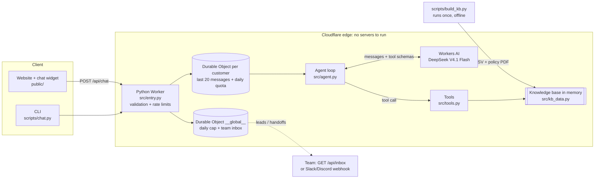
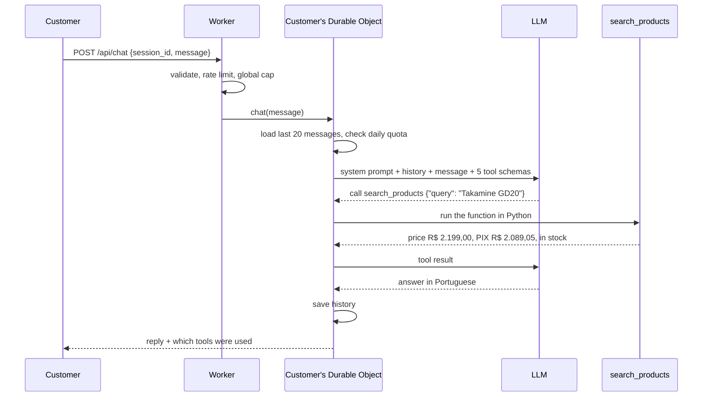

# Empório da Música: customer service agent

A text customer service agent for **Empório da Música**, a fictional musical instrument store in Campo Grande/MS. Written in Python, it runs on **Cloudflare Python Workers**. Every customer gets their own short-term memory. The agent looks up live catalog and order data, applies the store policy manual, captures sales leads and hands a conversation to a human when needed.

**Live demo:** https://emporio-agent.gulemes19.workers.dev: the store website, with the agent in the floating "Fale com a Lia" button (bottom-right) on every page. The tool calls the agent made are shown under each answer.

The site follows the visual language of the store's own policy manual: navy headings, an orange rule and navy-header tables. It has:
- a Three.js acoustic guitar in the hero; click it to hear an E major chord;
- featured products and categories, from live data (`GET /api/home`); clicking a product or category asks Lia about it;
- the full policy manual as web pages (`/politicas`, from `GET /api/policies`), plus a Privacy Policy (`/privacidade`), a Cookie Policy (`/cookies`) and Terms of use (`/termos`);
- an LGPD consent banner (Reject / Configure / Accept, with per-category preferences). The site sets no cookies at all: production responses carry no `Set-Cookie`. With consent, the browser keeps one random conversation id in `localStorage`, so Lia remembers the chat after a reload. Without consent the id lives only in memory, and the chat still works.

The agent talks to customers in **Brazilian Portuguese** (the store's language). Code, docs and this README are in English.

---

## What it does

| Customer asks about | Agent does |
|---|---|
| Prices, availability, promotions, specs | `search_products` on the catalog (never quotes a price without it) |
| Order status | `get_order_status`, only after the customer gives **order number + e-mail or phone** |
| Hours, address, payment/installments, returns, shipping, warranty, privacy | `get_store_policy` with the matching section of the manual |
| Buying intent ("can a salesperson call me?") | `register_lead` → team inbox (+ optional Slack/Discord webhook) |
| Complaints, return processing, "I want a person" | `handoff_to_human` → team inbox, tells the customer the 24 business-hour SLA |
| Accessories (strings, cases, amps...) | Explains the store only sells instruments (manual §1, §7.1) |
| Anything unrelated / prompt injection | Politely declines and steers back |

See [`examples/`](examples) for 5 real transcripts, including two non-trivial ones:
- [04: return request](examples/04-return-policy-with-order.md): the agent verifies the order, compares the delivery date with the 7-day and 30-day rules and escalates to a human.
- [05: purchase intent](examples/05-purchase-intent-lead.md): the agent checks the 12x installment rule against the price and registers a lead.

## Architecture



### What happens when a customer asks "Quanto custa o Takamine GD20?"



The model never knows a price by itself. It only decides which tool to call; the numbers always come from Python code over the store data.

### Where each piece of information lives

| Data | Where | Changes when |
|---|---|---|
| Catalog, orders, customers, promotions, policy manual | `src/kb_data.py`, built once by `scripts/build_kb.py` from `case/data/`, loaded in memory when the Worker starts | You rebuild and redeploy |
| Conversation history (last 20 messages) and daily quota | One Durable Object per `session_id` (SQLite storage at the edge) | Every message |
| Global daily cap, leads and handoffs | Durable Object `__global__` | Every message / event |
| Consent choice and conversation id | The visitor's browser (`localStorage`), only with consent for the id | When the visitor decides |

### How memory works

- The browser creates a random `session_id`, sent with every message.
- The Worker routes each `session_id` to its own Durable Object. That object stores the last 20 messages and the daily quota for this customer.
- Every turn, the agent receives that history, so follow-ups like "e no pix?" resolve without repeating the product.
- With storage consent, the id survives reloads, and the widget restores the conversation through `POST /api/history`.
- "Nova conversa" deletes the history on the server and starts a new id. The daily quota is kept, so resetting is no way around the limits.
- Identity is per session, not per person: there is no login. Order data is only shown after the order number + e-mail/phone check. A WhatsApp channel would use the phone number as the key, which gives memory across devices.

### Code layout and portability

- `src/agent.py`, `src/tools.py`, `src/prompt.py` and `src/site_data.py` are plain Python with no Cloudflare imports. They are unit-tested with a fake LLM.
- The LLM is injected as an async function, so the same agent runs on Workers AI (`src/entry.py`) or on any provider with your own key (`local/llm.py`).
- `src/entry.py` is the only file that touches Workers APIs (bindings, Durable Objects, fetch). `local/server.py` is its stand-in for running on a laptop: same routes, same website, SQLite instead of Durable Objects.

## Running it

Three ways, from zero setup to full control.

| | What you need | Command |
|---|---|---|
| **A. Live demo** | A browser | Open https://emporio-agent.gulemes19.workers.dev |
| **B. Locally with your own API key** (no Cloudflare) | [uv](https://docs.astral.sh/uv/) + one key: Claude, OpenAI, OpenRouter, Groq or DeepSeek | `uv run --group local python -m local.server` |
| **C. Locally on the Cloudflare runtime** (same stack as production) | uv, Node.js 18+, a free Cloudflare account | `uv run pywrangler dev` |

### B. With your own API key

```bash
cp .env.example .env        # uncomment ONE line and paste your key
uv run --group local python -m local.server
# open http://localhost:8787
```

| Provider | Variable in `.env` | Default model (override with `LLM_MODEL`) |
|---|---|---|
| Claude (Anthropic) | `ANTHROPIC_API_KEY` | `claude-opus-5-5`, through the official Anthropic SDK, with server-side refusal fallback enabled |
| OpenAI | `OPENAI_API_KEY` | `gpt-6-luna` |
| OpenRouter | `OPENROUTER_API_KEY` | `openai/gpt-6-luna` |
| Groq | `GROQ_API_KEY` | `openai/gpt-oss-20b` |
| DeepSeek | `DEEPSEEK_API_KEY` | `deepseek-flash` |

The first key found is used; `LLM_PROVIDER` picks one explicitly, and `LLM_BASE_URL` points the OpenAI-compatible adapter at any other endpoint. Memory goes to `.local/emporio.db` (SQLite). Leads and handoffs print in the terminal and are listed at `http://localhost:8787/api/inbox`.

### C. On the Cloudflare runtime

```bash
npx wrangler login                      # free account; Workers AI needs no API key
uv sync
cp .dev.vars.example .dev.vars          # optional: set ADMIN_TOKEN for the inbox
uv run pywrangler dev                   # http://localhost:8787
```

Team inbox: `curl -H "Authorization: Bearer <ADMIN_TOKEN>" http://localhost:8787/api/inbox`.

### Terminal client (works with A, B and C)

```bash
uv run python scripts/chat.py                                   # local server on :8787
uv run python scripts/chat.py https://emporio-agent.gulemes19.workers.dev
uv run python scripts/chat.py -m "Quanto custa o Takamine GD20?" -m "e no pix?"   # scripted transcript
```

### Tests

```bash
uv run --group local pytest
```

35 tests cover:
- catalog search, promotion and PIX rules, and order identity checks (including brute-force-style inputs);
- every policy topic, and the PDF → web page parser (with a check that every word of the manual is published);
- the agent loop: tool round trip, malformed arguments, step limit, LLM failure, history cap;
- the provider adapters (Claude message conversion, refusal handling, OpenAI-compatible requests) and the local HTTP server;
- store hours.

### Rebuild the knowledge base

`src/kb_data.py` is generated and committed, so the Worker needs no CSV/PDF parsing at runtime. To regenerate it after changing the data:

```bash
uv run python scripts/build_kb.py
```

### Deploy your own

```bash
uv run pywrangler deploy
npx wrangler secret put ADMIN_TOKEN          # protects GET /api/inbox
npx wrangler secret put TEAM_WEBHOOK_URL     # optional Slack/Discord incoming webhook
```

Config lives in `wrangler.jsonc` (`vars`): `MODEL`, `MAX_OUTPUT_TOKENS`, `DAILY_LIMIT_PER_SESSION`, `DAILY_LIMIT_GLOBAL`, `SHOW_TRACE`.

## Technical decisions

### Agent approach: function calling over structured data, not vector RAG

The questions in this domain fall into two very different kinds:

- **Operational data** (price, stock, promotions, orders) is structured and changes often. A typed tool with filters (`category`, `max_price`, `query`) returns exact, current values. Embedding these rows would add the risk of retrieving the wrong product or a stale price. That counts as misleading advertising under the store manual (§7.1).
- **Policies** are an 8-page manual with 10 numbered sections. Each section is exposed as a lookup topic (`opening_hours`, `returns_and_exchanges`, ...). The model picks the topic and gets the **full official text** of that section. At this size, a section lookup is deterministic and easy to audit, and it loses nothing to chunking. A vector store would add infrastructure without improving recall.

The decision between data and policy is made by the model through the tool descriptions and the system prompt rules. Tool calls are visible in the examples and in the UI, so this behavior can be checked.

I did not use a SQL agent: there are 6 small tables and only a handful of query shapes. Fixed, tested tools are safer than generated SQL, especially for the order lookup, which needs an identity check.

### Model and provider: Workers AI, DeepSeek V4.1 Flash

- **No API key to manage or leak.** The `AI` binding authenticates through the Cloudflare account. The public repo holds no secret, and a reviewer can run it with a free Cloudflare login.
- I checked the tool-calling format of several Workers AI models in a spike: `llama-3.3-70b-instruct-fp8-fast`, `gpt-oss-120b`, `glm-5.3-flash` and `deepseek-v4.1-flash-1017`. All returned OpenAI-style `tool_calls`. I chose DeepSeek V4.1 Flash and validated it end to end on the example scenarios. It handled Portuguese well, chained multiple tools (order + policy, product + payment policy) and kept its answers grounded.
- The model is one config value (`MODEL`), so it can be swapped without code changes.
- Outside Cloudflare, the same agent runs with Claude (official Anthropic SDK), OpenAI, OpenRouter, Groq or DeepSeek (option B in [Running it](#running-it)). The OpenAI-compatible path was verified end to end against a real OpenAI-format API (catalog lookup, follow-up memory, verified order lookup). Claude was covered with unit tests only, because no Anthropic key was available while I built this.

### Runtime: Cloudflare Python Workers + Durable Objects

- Python is the only mandatory constraint, and Python Workers (open beta) run it at the edge with no server to operate.
- **One Durable Object per customer session** gives simple, strongly consistent memory (last 20 messages) and a per-customer daily quota, with no external database.
- The same Durable Object class, under the fixed name `__global__`, holds the global daily cap and the team inbox.
- The runtime has **zero third-party Python dependencies**. This avoids the beta's package limitations, keeps cold start small (~0.4 s startup reported by deploy) and means the core logic runs anywhere Python runs.

### Why this architecture

I use this stack (Cloudflare Workers + Durable Objects, with a provider-agnostic agent core) across several projects, for these reasons:

- **Scale without thinking about infrastructure.** No servers, containers, load balancers or database to provision. Each customer conversation is its own Durable Object, so load spreads across Cloudflare's network on its own, and the free tier covers a demo like this.
- **Easy to change.** The core (agent loop, tools, prompt) is plain Python with the LLM injected. Swapping the model is one config value; swapping the provider is one adapter (`src/entry.py` for Workers AI, `local/llm.py` for Claude/OpenAI/OpenRouter/Groq/DeepSeek). Adding a capability is one function plus its JSON schema in `src/tools.py`.
- **Easy to integrate.** Everything is plain HTTP + JSON:
  - leads and handoffs come out through `GET /api/inbox` and an optional webhook, ready to feed a CRM or helpdesk;
  - the same `/api/chat` serves the website, the CLI or a WhatsApp gateway;
  - the store data could move to D1 (Cloudflare's SQL database) or to an existing ERP API by replacing only the tool functions.
- **Observable and cheap to run.** Tool calls are returned with every answer, Workers logs and traces are on, and the cost is capped in layers (see Security and cost controls).
- **No lock-in for the logic.** Option B runs the whole product on a laptop with SQLite and any API key, proving the core does not depend on Cloudflare.

Trade-offs, stated plainly:
- Python Workers is still in open beta.
- Durable Objects are Cloudflare-specific: the storage adapter would change on another cloud, though the agent would not.
- Workers AI models trail the frontier models. That is why the agent also runs with Claude or GPT through option B.

### Prompt strategy

- **Persona** ("Lia"): informal but professional, "a friend who knows music", from manual §7.1.
- **Numbered hard rules**: never state data not returned by a tool; promotions shown with original price + percent (§6.2); no PIX discount on promo prices; out-of-stock → suggest alternatives (§7.3); identity check before order data; escalate complaints (§7.3) and policy doubts (§10); only instruments, no accessories.
- **Live context injected every turn**: the current date and time in Campo Grande (UTC-4) and whether the store is open right now. This lets the model answer "are you open now?" and compute return windows (`days_since_delivery` comes from the tool).
- Sections 7 (service guidelines) and 10 (final provisions) of the manual are internal instructions for attendants, so they are also embedded in the system prompt.

### Data treatment

`scripts/build_kb.py` turns the raw files into `src/kb_data.py`:

- **Policy PDF**: extracted with `pypdf` (layout mode) and split by top-level section numbers. Numbered list items inside §7.2 ("1. Saudação...") are ignored as headings because sections must appear in sequence. Every section is kept, plus the cover page. A check confirmed that every word of the PDF is present in the knowledge base (only the "Página N" footers are dropped).
- **Products**: prices as numbers and specs parsed from JSON. The status (`active`, `discontinued`, `coming_soon`) and stock are combined into one availability flag.
- **Description/name mismatch**: in 6 products (ids 135, 137, 139, 140, 142, 144) the description describes a different brand than the name. Example: id 135 is named "Music Man Bass 1X" but is described as a "Fender Jazz Bass". Their descriptions are **dropped** so the agent does not present one instrument as another. Name, price, stock and specs are kept.
- **Promotions**: only `is_active = 1` rows are used. Promotions are not cumulative (§6.2), so if a product had two, the larger discount would win.
- **Orders**: joined with items and product names; statuses translated to plain Portuguese. For delivered orders the tool returns `days_since_delivery` and `days_since_purchase`.

### Security and cost controls

The public URL spends my Workers AI quota, so abuse is limited in layers:

1. Message ≤ 500 characters; session id format validated.
2. Burst limits with the Rate Limiting binding: 8 req/min per session, 20 req/min per IP.
3. A **strict global daily cap** on model calls (1,500/day), counted in a single Durable Object.
4. A per-session daily quota (40 messages), kept even if the customer resets the chat.
5. A bounded loop: at most 5 model calls per message and 900 output tokens per call.
6. When the model call fails (provider rate limit, outage), the customer gets a polite fallback with the store's WhatsApp, not an error.

Customer data protection (LGPD, manual §9):
- An order is only shown when the order number **and** the customer's e-mail or full phone number match.
- A wrong contact and a non-existent order produce the same response, so nobody can find out which order numbers exist.
- The team inbox requires a bearer token.
- Customer text sent to the team webhook is escaped, so it cannot trigger `@everyone` mentions or render as clickable links.

## Assumptions

- **Delivery format.** The case asks for a public GitHub repo; the recruiter e-mail asks for an English PDF via Google Forms. I deliver both: this repo, and a PDF linking to it.
- **Official phone number.** The manual gives two numbers: (67) 3341-4444 in the company data table (§1.2) and (67) 3321-4500 in §7. I treat §1.2 as authoritative. The contact e-mail is also written two ways (with and without an accent); the agent uses the non-accented one from the cover.
- **"Today".** The agent uses the real current date. The order data is from late 2025 to early 2026, so most delivered orders are now outside the return windows, and the agent says so. Order 8 is still "shipped" months after its estimate; the agent flags that as abnormal and offers a human handoff.
- **Delivery date.** For delivered orders, `estimated_delivery` is treated as the delivery date, since no actual delivery date is recorded.
- **Order totals.** The agent reports `total_brl` as recorded, even where it differs from the sum of the item prices (orders 3 and 20, likely discounts that were not recorded).
- **Holidays.** Holidays are not listed in the data, so "open now" only follows the weekly schedule. The prompt states this.

## Known limitations and next steps

- **Memory is per browser/CLI session**, not per real customer identity. With a WhatsApp integration, the phone number would be the Durable Object key, giving cross-session memory.
- **No real channel integration.** Next step: a WhatsApp Business webhook calling the same Worker.
- **Handoff is a queue, not a live transfer.** It goes to an inbox and optional webhook. A real deployment would create a ticket in the helpdesk and pause the bot for that session until a human replies.
- **Catalog search is keyword-based** (accent-insensitive, with filters). Typos like "takamini" are not matched. With more time: fuzzy matching or a small embedding index over product names only.
- **Rate limits are approximate per location** (a property of the binding). The global cap is strict, and it is the real cost ceiling.
- **No bot challenge.** I left out Cloudflare Turnstile on purpose for this demo; the layered limits cap the cost. Next step for production: an invisible Turnstile check before the first message of a session, validated in the Worker.
- **Privacy and terms pages** cover the site and the assistant (storage, conversation data, LGPD rights). They were written for this demo and are not legal advice.
- **Evaluation.** The examples were checked by hand. Next step: an automated eval set (question → expected tool calls + facts that must or must not appear), run against each prompt or model change.
- **Python Workers is in open beta**; a stable fallback would be the same `agent.py`/`tools.py` behind FastAPI on any host.

## Use of AI coding assistants

I used **Claude Code** (Anthropic's CLI agent, Claude Opus model) as a pair programmer throughout the project. My workflow:

- **I set the direction**: Cloudflare Workers + Durable Objects, memory per customer, lead capture and human handoff, layered abuse limits to protect my LLM usage, and the model choice (I rejected an option I didn't like and picked DeepSeek V4.1 Flash on Workers AI). I also asked that the policy manual be used in full, with nothing dropped.
- **Claude Code**:
  - inspected the case files (and first checked the zip for anything malicious);
  - surfaced the data inconsistencies listed above;
  - ran a small spike to check the tool-calling format of four Workers AI models before committing to one;
  - wrote the code and the tests;
  - ran the scenarios against the real model.
- **Iteration from real runs**: the scenario transcripts drove the prompt fixes, for example forbidding promises the tools can't keep (reservations) and grounding every claim in tool data after the model invented a manufacturer warranty period.
- **Security review**: an automated review hook flagged issues on commits (a phone-suffix match that was too loose in the order check, chat-markup injection in the webhook). Each one was fixed, with a regression test where applicable.
- I reviewed the changes and the transcripts, and the commit history shows the incremental progress.

## Repository layout

```
case/data/            raw data provided by the case (CSV + policy PDF)
scripts/build_kb.py   data treatment → src/kb_data.py
scripts/chat.py       terminal client (local or deployed)
local/llm.py          LLM adapters for your own key: Claude (Anthropic SDK), OpenAI, OpenRouter, Groq, DeepSeek
local/server.py       run everything locally without Cloudflare (same routes, SQLite memory)
src/entry.py          Worker routes, Durable Object, limits, Workers AI adapter
src/agent.py          agent loop (LLM-agnostic)
src/tools.py          tools + JSON schemas
src/prompt.py         system prompt, store hours
src/kb_data.py        generated knowledge base
public/               website: home (Three.js hero), policies, privacy, cookies, terms, chat widget, consent banner
src/site_data.py      website data: featured products, categories, manual → structured blocks
tests/                pytest suite
examples/             real conversation transcripts
```
