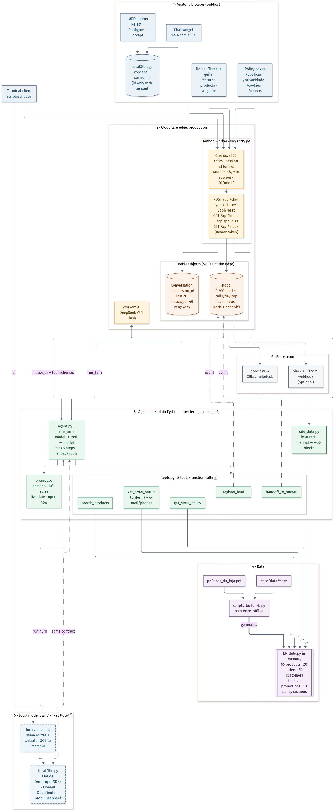
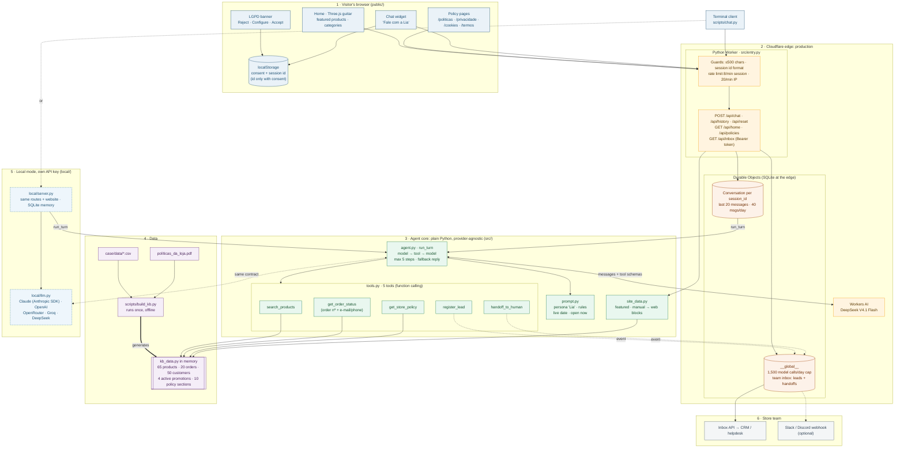

# Architecture: exploded view

One picture of every piece of the project and how the pieces connect: what runs in the browser, at the Cloudflare edge, in the agent core, at build time, and in local mode.

Same diagram as Mermaid source (rendered by GitHub, editable)

## How to read it

| Block | What it is | Key files |
|---|---|---|
| 1 · Browser | The store website: Three.js hero, real featured data, all policy pages, the LGPD banner with per-category preferences, and the floating chat. Nothing is stored without consent except the consent choice itself. | `public/` |
| 2 · Cloudflare edge | Production. The Python Worker validates and rate-limits each message. A Durable Object per customer keeps memory and quota, and a global one keeps the cost cap and the team inbox. The model is Workers AI, so the repo holds no API key. | `src/entry.py`, `wrangler.jsonc` |
| 3 · Agent core | Plain Python, no Cloudflare imports. The model only decides **which tool to call**; prices, stock, orders and policy text always come from Python over the knowledge base. | `src/agent.py`, `src/tools.py`, `src/prompt.py`, `src/site_data.py` |
| 4 · Data | The CSVs and the policy PDF are cleaned once into a Python module loaded in memory. At runtime nothing reads CSV or PDF. | `scripts/build_kb.py` → `src/kb_data.py` |
| 5 · Local mode | The same core and website on a laptop, with SQLite instead of Durable Objects and the reviewer's own key: Claude, OpenAI, OpenRouter, Groq or DeepSeek. | `local/server.py`, `local/llm.py` |
| 6 · Store team | Leads and "talk to a human" requests reach the team through an authenticated API and an optional chat webhook. | `GET /api/inbox`, `TEAM_WEBHOOK_URL` |

The step-by-step flow of a single question is the sequence diagram in the [README](../README.md#what-happens-when-a-customer-asks-quanto-custa-o-takamine-gd20).
