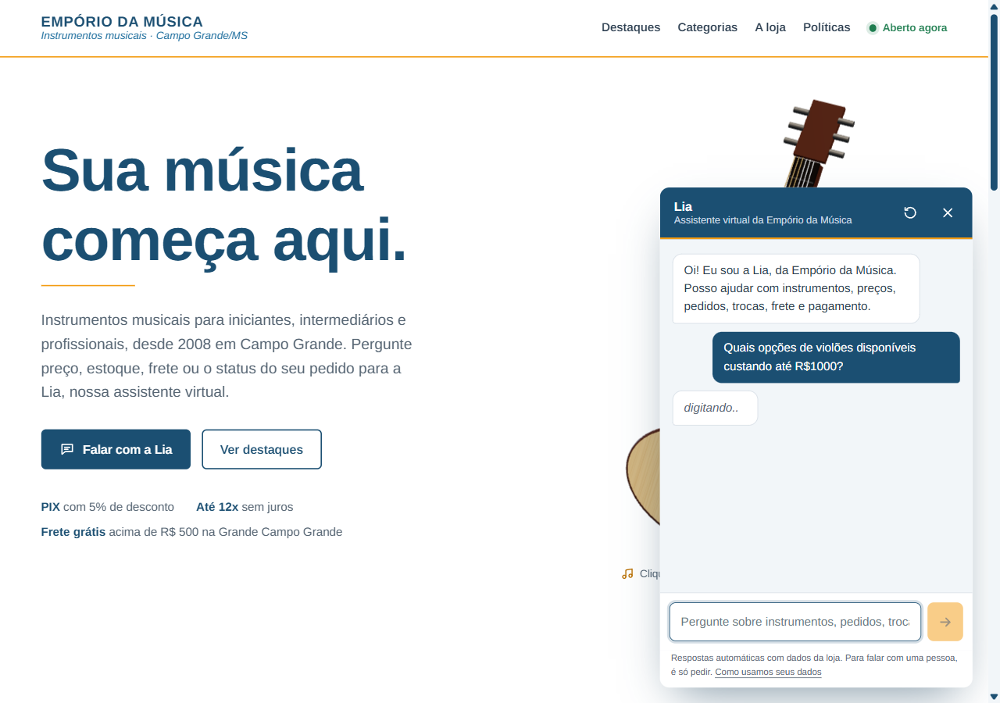
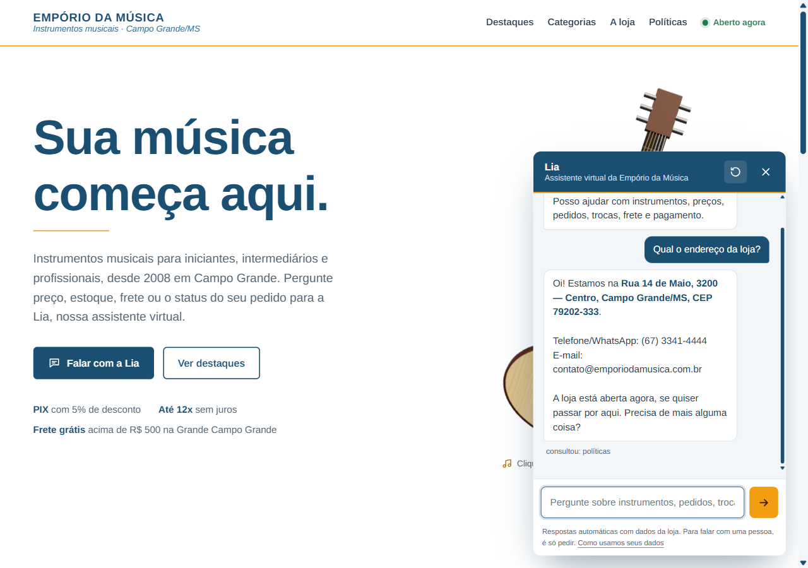
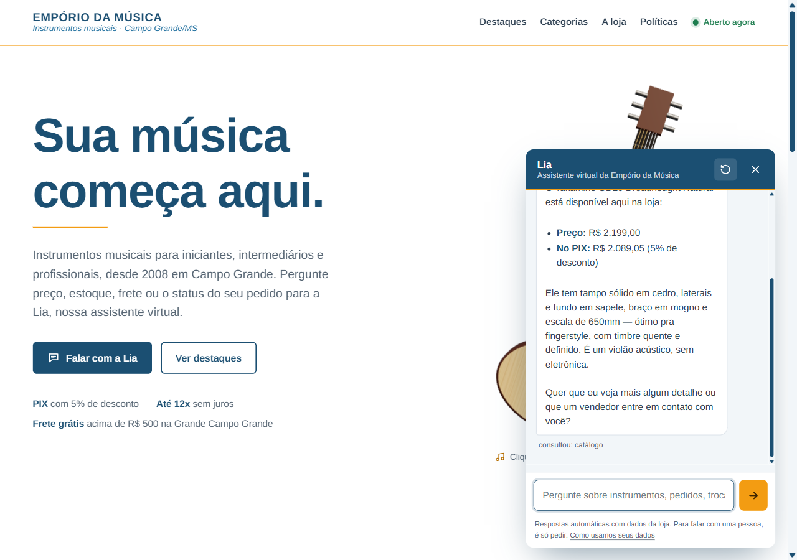
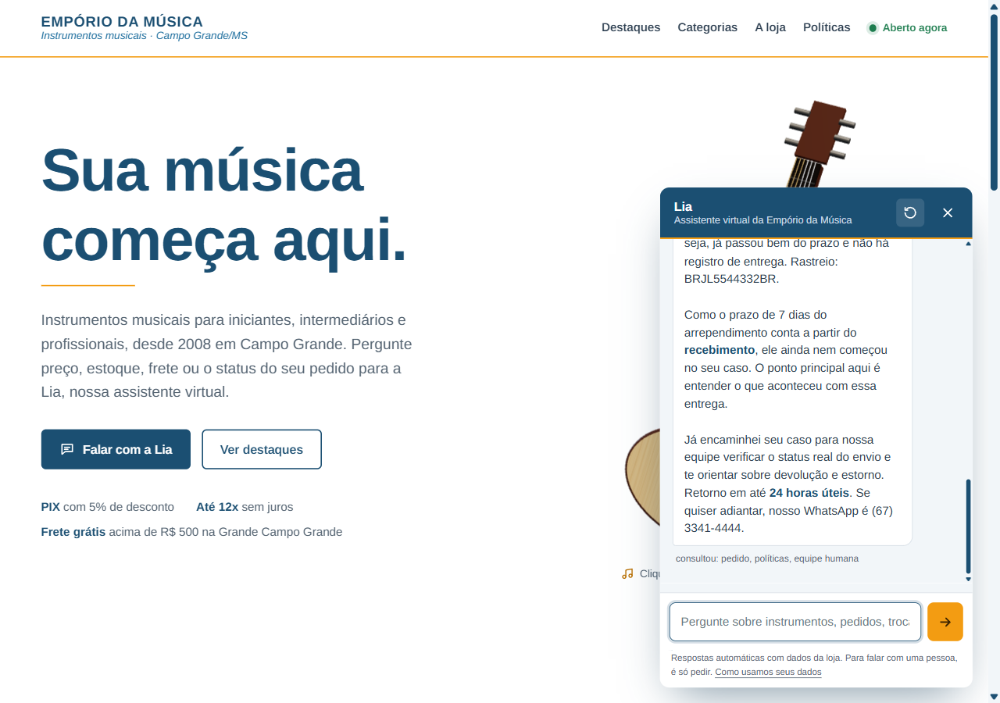
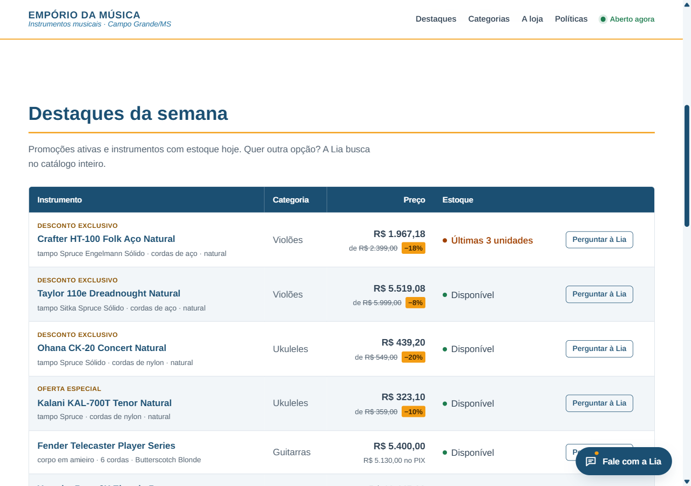

# Case verification

A check of the delivered project against the case brief (`Desafio Técnico - AI Engineer`, Artefact), done on 2026-10-31 against the **live deployment** (https://emporio-agent.gulemes19.workers.dev).

## The four scenarios suggested in the brief

Each scenario was run in a fresh chat session on the live website. The screenshots are full-page captures with the chat widget open. Every number in the answers was checked against the store data in `case/data/`.

### 1. "Quais opções de violões disponíveis custando até R$1000?" (catalog lookup)

- **Tools used:** `search_products(query="violão", category="Violões", max_price=1000)`
- **Answer:** 12 guitars up to R$ 1.000, 8 listed (4 nylon, 4 steel) with price and PIX price, "4 more" offered, then a follow-up question (nylon or steel?).
- **Check against data:** 12 *Violões* are in stock at ≤ R$ 1.000 in `products.csv`. Every listed price matches, and every PIX price equals price × 0.95.
- **Bug found and fixed during this check.** The first run said "6 more" instead of 4. The cause was the tool, not the model: when the model also sent a text query ("violão"), the search kept out-of-stock and discontinued items, so it counted 14. Two fixes:
  - the tool now lists only purchasable items when browsing, and keeps a sold-out item only when the customer names it;
  - the tool returns `not_shown`, the exact remaining count, so the model doesn't do the arithmetic.

  Both fixes have regression tests (commits `fix: report exact count…` and `fix: list only available items…`).

### 2. "Qual o endereço da loja?" (general store information)

- **Tools used:** `get_store_policy(topic="about_and_contact")`
- **Answer:** Rua 14 de Maio, 3200, Centro, Campo Grande/MS, CEP 79202-333; phone/WhatsApp (67) 3341-4444; e-mail. It also says the store is open now: Saturday, within the 09:00–13:00 window.
- **Check against data:** these are the manual's company data (§1.2) and opening hours (§2).

### 3. "Quanto custa o Takamine GD20?" (price lookup)

- **Tools used:** `search_products(query="Takamine GD20")`
- **Answer:** R$ 2.199,00, or R$ 2.089,05 on PIX (5% off), in stock. The specs (solid cedar top, sapele back/sides, mahogany neck, 650 mm, no electronics) come from the record.
- **Check against data:** product 95 in `products.csv` has price 2199, stock 5, and those specs. There is no active promotion, so the PIX discount applies (manual §3, §6.2).

### 4. "Me arrependi da minha compra, posso devolver meu pedido?" (returns policy, the non-trivial case)

1. **Turn 1, tools used: `get_store_policy(topic="returns_and_exchanges")`.** The agent explains the right of withdrawal: 7 calendar days after receipt, original packaging, refund within 10 business days, return shipping paid by the store, and the items that cannot be exchanged. Then it asks for the order number and the purchase e-mail/phone before looking anything up.
2. **Turn 2, tools used: `get_order_status(8, e-mail)`, `get_store_policy`, `handoff_to_human`.** Order 8 shows as *shipped / in transit* with an estimated delivery of 2026-02-28, months ago, and there is no delivery record. The agent reasons that the 7-day window counts from receipt and has not started, flags the stalled delivery, and hands the case to a human with the 24-business-hour SLA (manual §7.3).
- **Check against data:** `orders.csv` order 8 is customer 2 (`anacarol.ferreira@coldmail.com`), status `shipped`, tracking `BRJL5544332BR`, estimated delivery 2026-02-28, total R$ 349,90. Policy rules come from manual §4.1, §4.4 and §7.3.

The examples folder holds another return case: order 4, delivered 313 days ago, where the agent applies the 7-day and 30-day limits and offers manufacturer warranty mediation (`examples/04-return-policy-with-order.md`).

### The website table, as deployed

## Checklist against the brief

| Brief item | Status | Evidence |
|---|---|---|
| Python project, text messaging agent | Done | `src/` (agent, tools, prompt, Worker); `local/` (local server) |
| Persona aligned with the store's identity and tone | Done | `src/prompt.py`; tone from manual §7.1, "Lia" |
| Answers based on the provided context | Done | `scripts/build_kb.py` → `src/kb_data.py` (all CSVs + every section of the policy PDF) |
| Knows when to query data vs. policies | Done | Tool traces in the 4 scenarios above and in `examples/` |
| Handles out-of-scope questions | Done | `examples/01` (accessories), `examples/02` (prompt injection / off-topic) |
| Technical decisions justified in the README: framework/approach, model and provider, interface, conversation history, data treatment | Done | README → Technical decisions, Why this architecture, How memory works, Data treatment |
| Only mandatory constraint: Python | Done | All runtime logic is Python; the website is static HTML/JS served by the Python Worker |
| 1. Public Git repository with real commit history, no single force-pushed commit | Done | https://github.com/lobodosaas/emporio-agent: incremental commits, no force-push |
| 1. Do not change the repository after the delivery date | Pending (behavior) | Stop pushing once the submission is sent (deadline 2026-11-03 23:59) |
| 2. README: everything needed to run (environment, model provider, commands) | Done | README → Running it (live demo, own API key, Cloudflare runtime), Tests, Deploy |
| 2. README: justification of technical decisions | Done | README → Technical decisions |
| 2. README: known limitations and what I'd do with more time | Done | README → Known limitations and next steps |
| 2. README: use of AI coding assistants and workflow | Done | README → Use of AI coding assistants |
| 3. Between 3 and 5 example conversations (.md / .txt / image) | Done | 5 files in `examples/` (the 4 scenarios here are verification, not extra examples) |
| 3. At least one non-trivial example (live data or policy rules) | Done | `examples/04` (order + return rules + handoff), `examples/05` (installment rule + lead), scenario 4 above |
| Ambiguities: assume, document in README, move on | Done | README → Assumptions (delivery format, phone number, "today", delivery date, order totals, holidays) |
| How to deliver: link to the public repository | Ready | Delivery PDF in English with the repository link, for the recruiter's Google Form |

## Automated tests

`uv run --group local pytest` → **38 passed**. The suite covers catalog search and its availability rules, promotions and PIX, order identity checks, policy coverage (every word of the manual is published), the agent loop, provider adapters, the local server (including its block on cross-site requests) and store hours.
